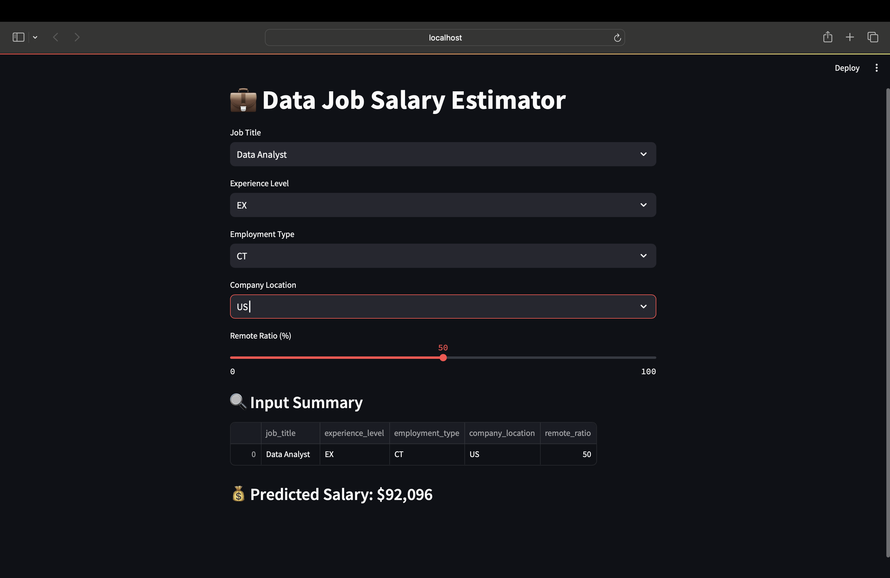

# 💼 Data Job Salary Estimator

A sleek and interactive web app that predicts salaries for data-related roles based on job title, experience level, company location, employment type, and remote ratio.

Built with 💖 using Python, Streamlit, and Machine Learning.

---

## 🚀 Live Demo (Optional)
(https://salary-estimator.streamlit.app/)

---

## 🧠 What This Project Does

This project:
- Uses real-world job salary data
- Trains a machine learning model to estimate salaries
- Provides an easy-to-use interface for salary prediction
- Helps users understand the impact of location, role, and remote work

---

## 📸 Demo Screenshot

 

---

## 🧰 Tech Stack

| Tool        | Role                          |
|-------------|-------------------------------|
| `Python`    | Programming language          |
| `Pandas`    | Data cleaning & analysis      |
| `scikit-learn` | ML pipeline & model        |
| `joblib`    | Save/load model               |
| `Streamlit` | Web app framework             |

---

## 📁 Project Structure

```bash
data-salary-dashboard/
│
├── app.py                    # Streamlit web app interface
├── train_model.py            # Script to preprocess and train the ML model
├── salary_model.pkl          # Serialized ML model (includes preprocessing pipeline)
├── job_analysis_mini_lab.ipynb  # EDA + model development notebook (Colab)
├── requirements.txt          # Python dependencies
├── screenshot.png            # UI screenshot used in README
├── README.md                 # Project overview (you're reading it!)
└── .gitignore                # Files/folders to be excluded from Git

Last updated: 2026-10-26 00:48 UTC
